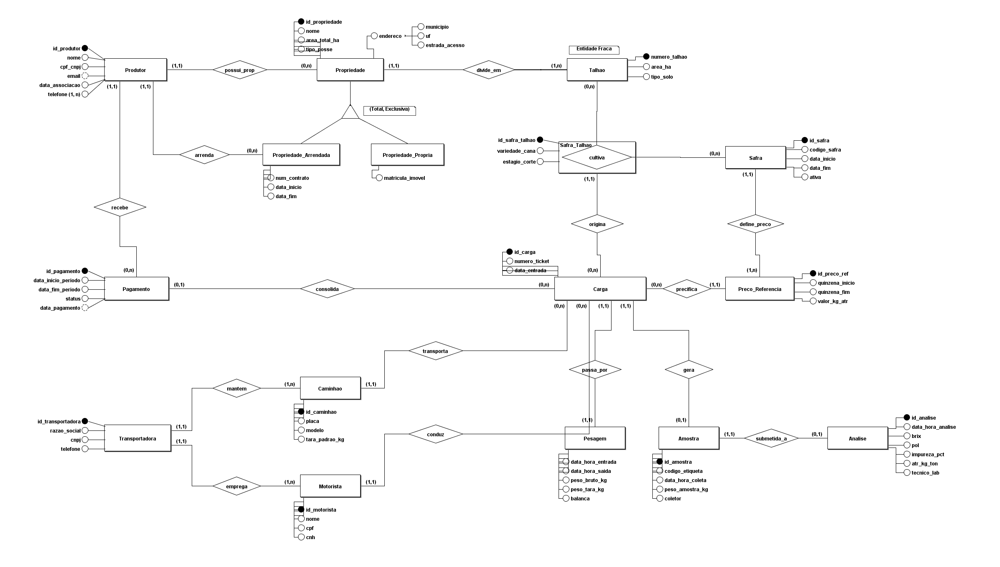

# Cooperativa Agrícola

Projeto integrado das disciplinas de **Linguagem de Programação 1** e **Banco de Dados**, composto pela modelagem completa de um banco de dados relacional em **MariaDB/MySQL** e por uma aplicação desktop CRUD em **C# Windows Forms (.NET Framework 4.7.2)**.

## Contexto

Uma cooperativa agrícola da região recebe cana-de-açúcar de produtores associados. Cada carga transportada por empresas terceirizadas é pesada na balança, podendo passar por coleta de amostra e análise laboratorial. O valor devido depende da qualidade medida (ATR) e do preço de referência vigente na quinzena, sendo o pagamento consolidado por período ao produtor beneficiário.

## Características do Projeto

- **Modelagem Conceitual Estendida (MER):** elaborada no brModelo 3.3.3 com cardinalidades `(mín, máx)` na convenção de Heuser, incluindo entidade fraca (`Talhao` dependente de `Propriedade`), especialização total e exclusiva (`Propriedade_Propria` e `Propriedade_Arrendada`), entidade associativa (`Safra_Talhao` entre `Talhao` e `Safra`, ligada à `Carga`), atributo multivalorado (`telefone`) e atributo composto (`endereco`).
- **Normalização em 3FN:** todas as 17 tabelas do banco atendem à Terceira Forma Normal, sem dependências parciais ou transitivas.
- **Rastreabilidade financeira e histórica:** cada carga guarda a referência exata do preço da quinzena (`id_preco_ref`), permitindo reconstituir meses depois o cálculo do valor pago a partir do peso líquido, do ATR medido e do valor do kg de ATR praticado na data.
- **Regra de arrendamento:** em propriedades próprias o pagamento é creditado ao proprietário; em propriedades arrendadas o pagamento é creditado ao arrendatário, mantendo o registro distinto entre dono da terra e beneficiário.
- **Sem dados derivados armazenados:** peso líquido (`peso_bruto_kg - peso_tara_kg`), valor individual da carga e total de cada pagamento são sempre apurados dinamicamente via SQL.
- **Aplicação simples e segura:** interface Windows Forms organizada em abas, utilizando a classe de acesso `Banco.cs` com comandos SQL parametrizados (`@Param`) contra SQL Injection e tratamento de exceções.

## Funcionalidades da Aplicação CRUD

A aplicação (`Form1.cs`) é organizada em 7 abas principais:

1. **Produtores:** inclusão, consulta, busca por nome, edição e exclusão de produtores associados e telefone de contato.
2. **Propriedades:** cadastro de propriedades rurais com seleção de proprietário, endereço completo e alternância automática dos campos conforme o tipo de posse (`PROPRIA` com matrícula ou `ARRENDADA` com contrato, vigência e arrendatário).
3. **Talhões:** manutenção dos talhões vinculados à propriedade (chave primária composta por propriedade e número do talhão).
4. **Cargas e Pesagem:** registro conjunto da carga recebida (ticket, data, cultivo safra/talhão, caminhão, motorista, preço da quinzena e pagamento opcional) e da pesagem obrigatória na balança, exibindo o peso líquido calculado na grade.
5. **Amostras e Análises:** controle opcional de amostragem e registro/atualização dos índices laboratoriais (Brix, Pol, percentual de impureza e ATR).
6. **Pagamentos:** fechamento por período para o produtor beneficiário, controle de status (`PENDENTE` ou `PAGO` com data obrigatória) e visualização do valor total calculado das cargas vinculadas.
7. **Consultas (E6):** seleção e execução interativa das 10 consultas SQL do projeto (5 do enunciado e 5 propostas pelo grupo), exibindo o comando SQL e o resultado na grade.

## Resumo das Entregas

| Entrega | Descrição | Arquivos |
|---|---|---|
| **E1** | Minimundo e 15 regras de negócio numeradas (RN01 a RN15) em texto corrido. | [Entregas/E1_Minimundo_e_Regras_de_Negocio.pdf](Entregas/E1_Minimundo_e_Regras_de_Negocio.pdf) |
| **E2** | Modelo Conceitual (MER estendido) no brModelo 3.3.3, imagem exportada e documentação. | [Entregas/E2_Modelo_Conceitual.brM3](Entregas/E2_Modelo_Conceitual.brM3), [Entregas/E2_Modelo_Conceitual.png](Entregas/E2_Modelo_Conceitual.png), [Entregas/E2_Modelo_Conceitual.pdf](Entregas/E2_Modelo_Conceitual.pdf) |
| **E3** | Mapeamento completo para o modelo lógico (17 tabelas, PKs, FKs e justificativas de 3FN). | [Entregas/E3_Modelo_Logico.pdf](Entregas/E3_Modelo_Logico.pdf) |
| **E4** | Script DDL completo com `PRIMARY KEY`, `FOREIGN KEY`, `NOT NULL`, `UNIQUE` e `CHECK`. | [sql/E4_ddl.sql](sql/E4_ddl.sql) |
| **E5** | Carga inicial com >= 10 registros nas tabelas principais, >= 20 nas associativas/movimentação e casos de borda. | [sql/E5_dados_iniciais.sql](sql/E5_dados_iniciais.sql) |
| **E6** | 10 consultas SQL (5 do enunciado + 5 do grupo) com resultados reais e integração na aplicação C#. | [sql/E6_consultas.sql](sql/E6_consultas.sql), [Entregas/E6_Consultas_SQL.pdf](Entregas/E6_Consultas_SQL.pdf) |
| **E7** | Demonstração de integridade com 3 comandos que falham (FK, PK composta e CHECK) e mensagens exatas do SGBD. | [sql/E7_integridade.sql](sql/E7_integridade.sql), [Entregas/E7_Demonstracao_Integridade.pdf](Entregas/E7_Demonstracao_Integridade.pdf) |
| **Resumo** | Documento consolidado resumindo todas as entregas do projeto. | [Entregas/ResumoEntregas.pdf](Entregas/ResumoEntregas.pdf) |
| **Dump** | Exportação completa (estrutura e dados) do banco `cooperativa_agricola` via `mysqldump`. | [sql/dump_cooperativa_agricola.sql](sql/dump_cooperativa_agricola.sql) |

### Modelo Conceitual (MER Estendido)



## Requisitos

- **Sistema Operacional:** Windows
- **Visual Studio** (com a carga de trabalho *Desenvolvimento para desktop .NET* e **.NET Framework 4.7.2**)
- **XAMPP** (servidor MariaDB/MySQL na porta `3306`, usuário `root`, sem senha)
- **MySQL Workbench** (opcional, para administração visual e execução dos scripts SQL)
- **Pacote NuGet:** `MySql.Data` (restaurado automaticamente pelo Visual Studio / MSBuild)
- **brModelo 3.3.3** (Java JRE) para abrir o arquivo `.brM3`

## Modo de Funcionamento (Como Executar)

### 1. Subir o Banco de Dados
1. Abra o **XAMPP Control Panel** e clique em **Start** no módulo **MySQL** (`localhost`, porta `3306`).
2. Importe o banco de uma das duas formas abaixo (via MySQL Workbench, phpMyAdmin ou linha de comando):
   - **Opção rápida (Dump completo):** execute [sql/dump_cooperativa_agricola.sql](sql/dump_cooperativa_agricola.sql).
   - **Opção passo a passo:** execute primeiro [sql/E4_ddl.sql](sql/E4_ddl.sql) e em seguida [sql/E5_dados_iniciais.sql](sql/E5_dados_iniciais.sql).

### 2. Executar a Aplicação C#
1. Abra a solução [Cooperativa_Agricola.slnx](Cooperativa_Agricola.slnx) no **Visual Studio**.
2. Aguarde a restauração automática do pacote NuGet `MySql.Data` (ou clique com o botão direito na solução e escolha **Restaurar Pacotes NuGet**).
3. Pressione **F5** para compilar e iniciar o sistema.

> Caso o MySQL/MariaDB local utilize outra porta ou senha, ajuste a `connectionString` em [Banco.cs](Banco.cs).

### 3. Testar Consultas e Integridade
- As 10 consultas da **E6** podem ser executadas diretamente na aba **Consultas (E6)** da aplicação ou rodando [sql/E6_consultas.sql](sql/E6_consultas.sql) no Workbench.
- Os 3 testes de violação de integridade da **E7** podem ser reproduzidos executando [sql/E7_integridade.sql](sql/E7_integridade.sql) (cada comando deve retornar o respectivo erro de `FOREIGN KEY`, `PRIMARY KEY` ou `CHECK`).

## Estrutura do Projeto

```text
Cooperativa_Agricola/
├── Banco.cs                         # Conexão e métodos parametrizados com MariaDB/MySQL
├── Form1.cs                         # Lógica do CRUD e das consultas SQL (E6)
├── Form1.Designer.cs                # Layout das 7 abas no Windows Forms
├── Program.cs                       # Ponto de entrada da aplicação
├── Cooperativa_Agricola.csproj      # Projeto .NET Framework 4.7.2 com MySql.Data
├── Cooperativa_Agricola.slnx        # Solução Visual Studio
├── Entregas/                        # Documentação das entregas (.pdf), modelo brModelo (.brM3) e imagem (.png)
└── sql/                             # Scripts DDL (E4), dados (E5), consultas (E6), integridade (E7) e dump
```

## Participantes

- Gabriel de Oliveira
- Otavio Gomes
- Paulo César
- Reinaldo Santiago
